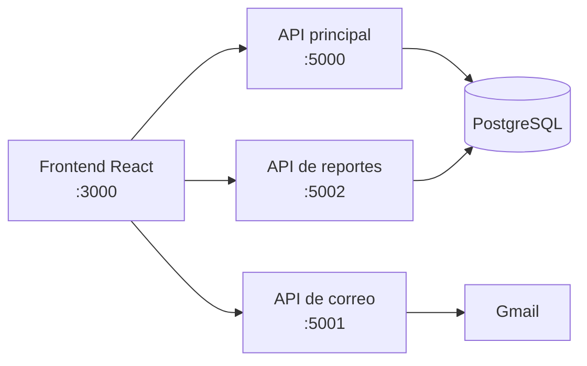

# 🐾 RUFO: plataforma de adopción de mascotas

Aplicación web full stack para administrar un albergue de animales: da a conocer a las mascotas en adopción, recibe y da seguimiento a las solicitudes, y ofrece paneles internos para el personal y la administración.

Se desarrolló en equipo como proyecto modular universitario para el albergue **Patitas de la Calle**.


## Funcionalidades

**Sitio público**
- Catálogo de mascotas con búsqueda, filtros y paginación
- Formulario de solicitud de adopción
- Secciones de donaciones, eventos, voluntariado y acerca de nosotros

**Cuentas y acceso**
- Registro e inicio de sesión con correo y contraseña, Google o Facebook
- Sesiones con JWT y tres tipos de cuenta: administrador, personal y adoptante

**Paneles internos**
- Gestión de mascotas, solicitudes, donativos y usuarios
- Reportes descargables en Excel de mascotas, solicitudes y adoptantes

| Catálogo de adopción | Reportes de administración |
| --- | --- |
|  |  |

> Las capturas se tomaron sin el backend conectado, por lo que el catálogo aparece sin mascotas.

## Tecnologías

| Área | Herramientas |
| --- | --- |
| Frontend | React 17, React Router 6, React Table, Axios, CSS |
| Backend | Node.js, Express |
| Base de datos | PostgreSQL, pg-promise |
| Autenticación | Passport (local, JWT, Google OAuth 2.0, Facebook) |
| Servicios | Nodemailer con Gmail OAuth2, excel4node |

## Arquitectura

El frontend consume tres servicios Express independientes:



```text
├── src/             # Frontend: páginas públicas, paneles internos y componentes
├── public/          # Archivos estáticos
├── backend-tests/   # API principal: mascotas, usuarios, sesión, solicitudes y donativos
├── email-api/       # Envío de correos
└── excel_api/       # Generación de reportes en Excel
```

## Ejecución local

**Requisitos:** Node.js 18 y PostgreSQL.

1. Crea un archivo `.env` en cada servicio a partir de su plantilla y completa tus valores:

   ```bash
   cp backend-tests/.env.example backend-tests/.env
   cp email-api/.env.example email-api/.env
   cp excel_api/.env.example excel_api/.env
   ```

2. Inicia cada servicio en su propia terminal:

   ```bash
   cd backend-tests && npm install && npm start
   cd email-api && npm install && npm start
   cd excel_api && npm install && npm start
   ```

3. Inicia el frontend desde la raíz del proyecto y abre <http://localhost:3000>:

   ```bash
   npm install
   npm start
   ```

> El esquema SQL de la base de datos todavía no está incluido en este repositorio, así que necesitas crear las tablas para usar las funciones que dependen del backend.

## Mi participación

Mis aportaciones se concentraron en el frontend:

- Páginas internas y menús para administradores, personal y adoptantes
- Pantallas de "Mi cuenta" para cada tipo de usuario
- Páginas de reportes de administración
- Botones de agregar, modificar y eliminar en las tablas de gestión
- Ajustes de la interfaz para distintos tamaños de pantalla

## Mejoras pendientes

- Sustituir MD5 por bcrypt o Argon2 para guardar las contraseñas
- Proteger las rutas internas también en el frontend
- Centralizar las URL de los servicios, ahora escritas para `localhost`
- Agregar el esquema SQL, pruebas automatizadas y Docker
- Actualizar dependencias, entre ellas `react-scripts`

## Sobre este repositorio

Esta es una versión pública del proyecto. Se publica con un historial nuevo y sin credenciales, datos personales ni reportes generados. Los datos de cuenta que aparecen en la interfaz son de demostración.
