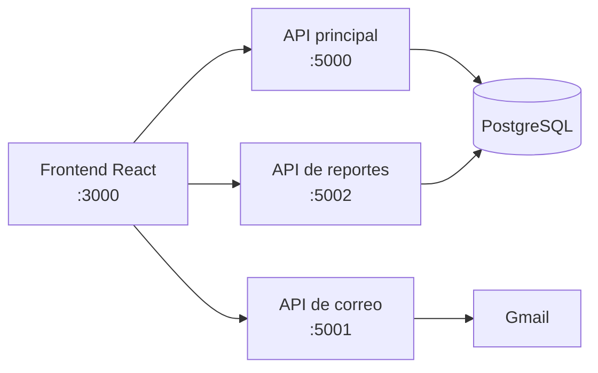

# 🐾 RUFO: Rescued and Unidentified Fluffy Object

Plataforma web full stack para la adopción responsable de perros y la gestión interna de albergues. Responde a la sobrepoblación de perros sin hogar en Guadalajara, Jalisco, y recomienda mascotas según las preferencias de cada adoptante.

Es un proyecto modular universitario del Centro Universitario de Ciencias Exactas e Ingenierías (CUCEI, UdeG), desarrollado en equipo junto con el albergue **Patitas de la Calle**.

📄 **[Leer el documento del proyecto (PDF)](docs/RUFO-2024A.pdf)**


> [!NOTE]
> **Qué código contiene este repositorio:** una versión anterior de la aplicación, con el frontend y los servicios Express, y el código del sistema de recomendación de la versión final en [`recomendador/`](recomendador/). TypeORM, Docker y el despliegue en la nube pertenecen a la versión final (2024A), que está en un repositorio privado del equipo; esas partes se describen aquí y en el documento, pero su código no está publicado en este repositorio.

## Mi participación

### ⭐ Aportación principal: Módulo II, Justificación de Sistemas Inteligentes

Estuve a cargo del módulo de sistemas inteligentes, que incorpora al proyecto un sistema de recomendación de mascotas:

- El módulo comenzó con k-vecinos más cercanos (k-NN) y evolucionó a similitud de coseno para evaluar mejor la afinidad entre las preferencias del usuario y las características de cada perro.
- Las recomendaciones consideran sexo, talla, edad y personalidad.
- Los resultados se presentan como "Matches" con los 25 perros más compatibles.

La separación del algoritmo como API la realizó el compañero responsable de la estructura del proyecto. El código está en [`recomendador/`](recomendador/).

### Otras aportaciones al frontend

- Interfaz de recomendaciones
- Páginas internas y menús para administradores, personal y adoptantes
- Pantallas de "Mi cuenta" para cada tipo de usuario
- Páginas de reportes de administración
- Botones de agregar, modificar y eliminar en las tablas de gestión
- Ajustes de la interfaz para distintos tamaños de pantalla

## Sistema de recomendación

1. El usuario abre "Recomendar" en la sección de adopción y elige sus preferencias: sexo, talla, edad y tres o más rasgos de personalidad.
2. Esas preferencias se convierten en un vector.
3. La similitud de coseno compara ese vector con el de cada perro en la base de datos:

   $$\text{similitud} = \cos(\theta) = \frac{A \cdot B}{\|A\|\,\|B\|}$$

4. Los resultados se ordenan de mayor a menor similitud, donde un valor más cercano a 1 indica mayor compatibilidad.

**Rasgos de personalidad:** activo, amigable, amoroso, juguetón, obediente, protector, sociable, tierno, tímido y tranquilo.

| Selección de preferencias | Matches mostrados al usuario |
| --- | --- |
|  |  |

## Módulos del proyecto

| Módulo | Enfoque | Contenido |
| --- | --- | --- |
| I | Arquitectura y programación de sistemas | Node.js, React, PostgreSQL, Scrum y modelado del sistema |
| **II** | **Sistemas inteligentes** | **Recomendación con k-NN y similitud de coseno** |
| III | Sistemas distribuidos | Docker, modelo cliente-servidor y microservicios en Google Cloud |

## Funcionalidades

**Sitio público**
- Catálogo de mascotas con búsqueda, filtros y paginación
- Solicitud de adopción en línea
- Secciones de donaciones, eventos, voluntariado y acerca de nosotros

**Cuentas y acceso**
- Registro e inicio de sesión con correo y contraseña, Google o Facebook
- Sesiones con JWT y tres tipos de cuenta: administrador, personal y adoptante

**Paneles internos**
- Gestión de mascotas, solicitudes, donativos y usuarios
- Reportes descargables en Excel de mascotas, solicitudes y adoptantes

| Catálogo de adopción | Reportes de administración |
| --- | --- |
|  |  |

> Estas dos capturas se tomaron de este código sin el backend conectado, por lo que el catálogo aparece sin mascotas.

## Tecnologías

| Área | Herramientas | Versión |
| --- | --- | --- |
| Frontend | React, React Router, React Table, Axios, CSS | Ambas |
| Backend | Node.js, Express | Ambas |
| Base de datos | PostgreSQL | Ambas |
| Autenticación | Passport (local, JWT, Google OAuth 2.0, Facebook) | Este repositorio |
| Servicios | Nodemailer con Gmail OAuth2, excel4node | Este repositorio |
| Inteligencia artificial | Similitud de coseno, k-NN con scikit-learn y pandas, Flask | Final, con el código en `recomendador/` |
| Migraciones | TypeORM | Final |
| Infraestructura | Docker, Docker Compose, Google Cloud | Final |
| Diseño y gestión | Figma, Scrum | Ambas |

## Arquitectura

### Versión final (2024A)

Cuatro contenedores Docker, orquestados con Docker Compose en una máquina virtual Debian de Google Cloud: servidor web, API con el algoritmo, base de datos PostgreSQL y ORM.


### Código de este repositorio

El frontend consume tres servicios Express independientes:



```text
├── src/             # Frontend: páginas públicas, paneles internos y componentes
├── public/          # Archivos estáticos
├── backend-tests/   # API principal: mascotas, usuarios, sesión, solicitudes y donativos
├── email-api/       # Envío de correos
├── excel_api/       # Generación de reportes en Excel
├── recomendador/    # Sistema de recomendación de la versión final
└── docs/            # Documento del proyecto, figuras y capturas
```

## Metodología

El equipo trabajó con Scrum, con sprints, reuniones semanales de seguimiento y un tablero de tareas. Los errores se registraban como tickets de prioridad baja, media o alta.

El diseño partió de mapas de empatía para rescatistas, adoptantes y personal, y de prototipos en Figma. El sistema se modeló con diagramas de casos de uso, entidad-relación y de flujo. El detalle está en el [documento del proyecto](docs/RUFO-2024A.pdf).

## Ejecución local

Estos pasos corresponden al código de este repositorio.

**Requisitos:** Node.js 18 y PostgreSQL.

1. Crea un archivo `.env` en cada servicio a partir de su plantilla y completa tus valores:

   ```bash
   cp backend-tests/.env.example backend-tests/.env
   cp email-api/.env.example email-api/.env
   cp excel_api/.env.example excel_api/.env
   ```

2. Inicia cada servicio en su propia terminal:

   ```bash
   cd backend-tests && npm install && npm start
   cd email-api && npm install && npm start
   cd excel_api && npm install && npm start
   ```

3. Inicia el frontend desde la raíz del proyecto y abre <http://localhost:3000>:

   ```bash
   npm install
   npm start
   ```

> Este repositorio no incluye el esquema SQL, así que necesitas crear las tablas para usar las funciones que dependen del backend.

## Mejoras pendientes

**En el código de este repositorio**
- Sustituir MD5 por bcrypt o Argon2 para guardar las contraseñas
- Proteger las rutas internas también en el frontend
- Centralizar las URL de los servicios, ahora escritas para `localhost`
- Agregar el esquema SQL y pruebas automatizadas
- Actualizar dependencias, entre ellas `react-scripts`

**En el proyecto, según el documento**
- Métodos de pago para donaciones
- Apartado de eventos
- Blog sobre el cuidado de las mascotas

## Sobre este repositorio

Esta es una versión pública del proyecto, con historial nuevo y sin credenciales ni reportes generados. Los datos de cuenta que aparecen en la interfaz son de demostración. El documento del proyecto se incluye en su versión original, con la autoría del equipo.
