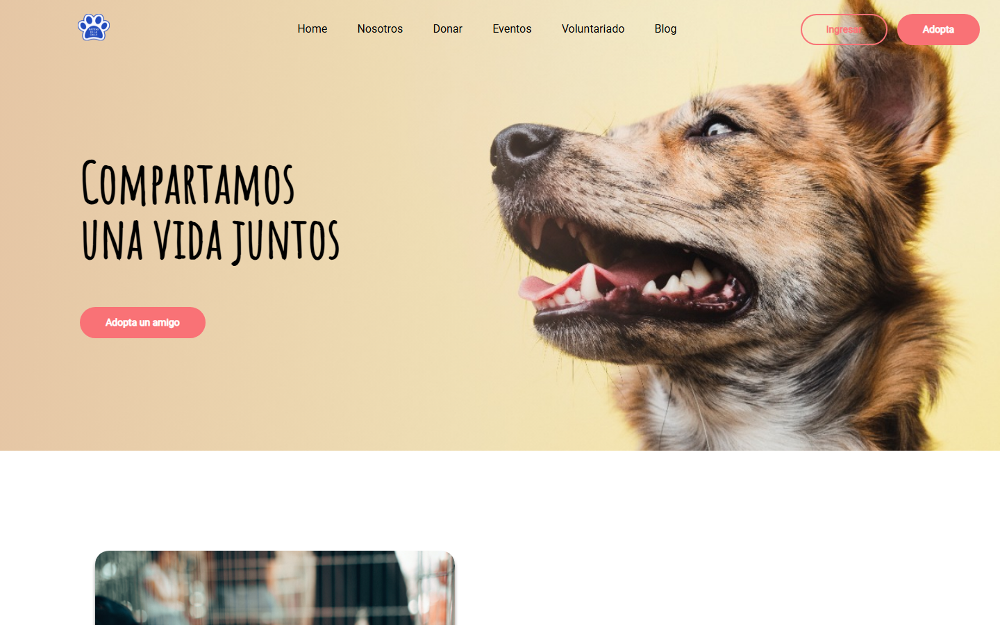
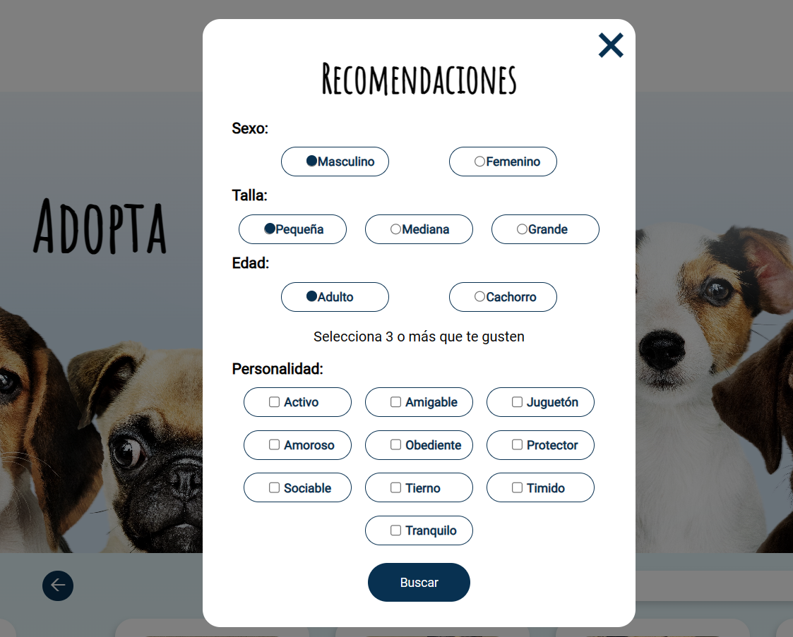
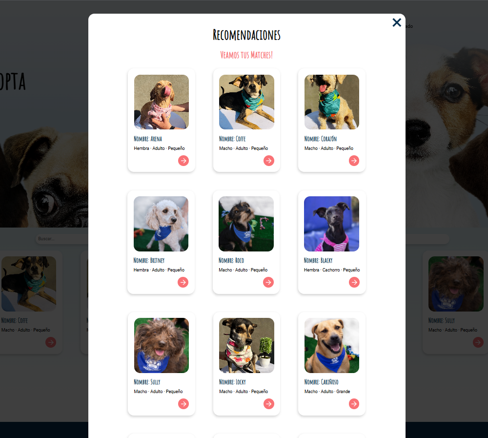
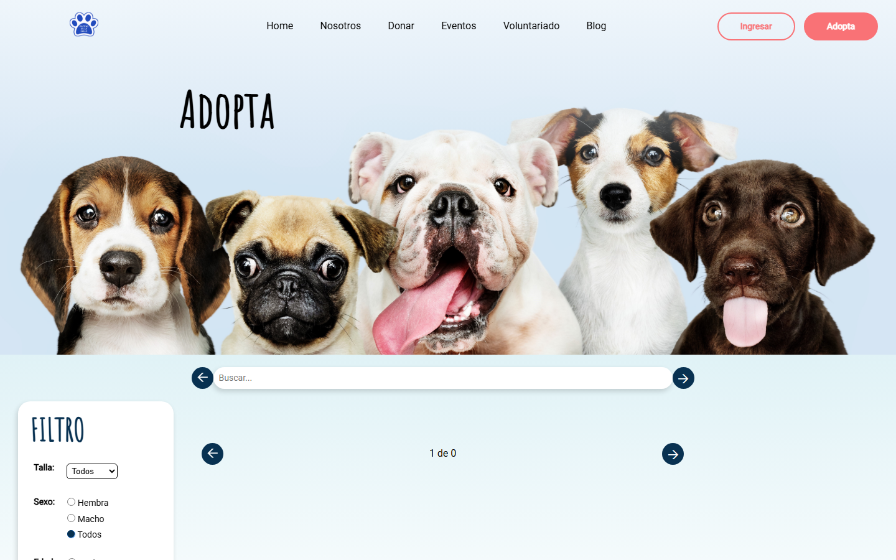
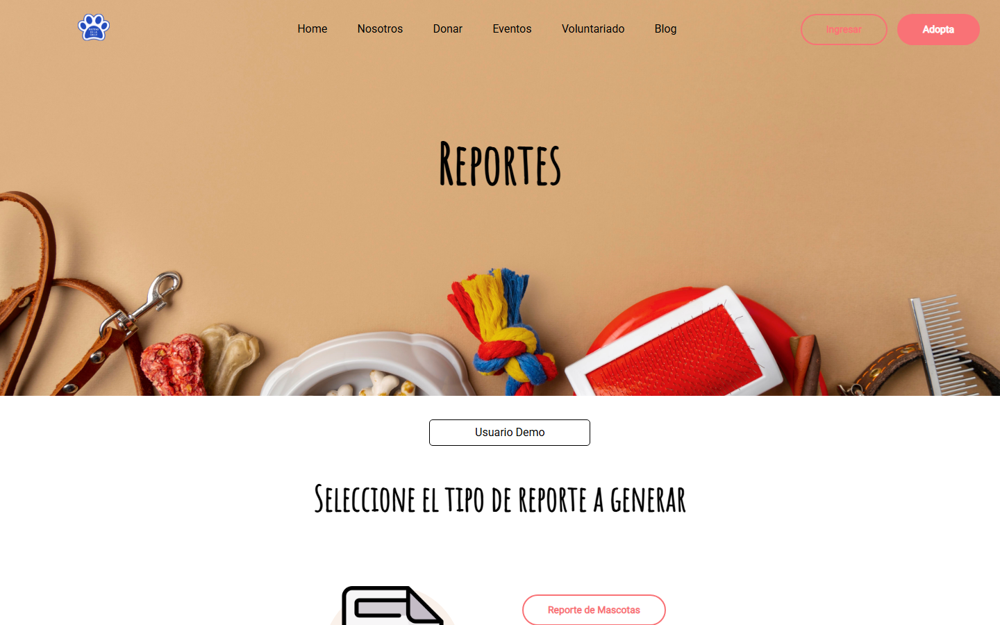
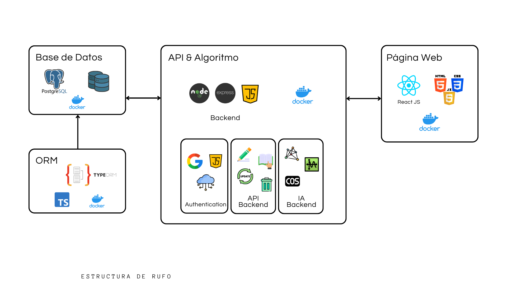

# 🐾 RUFO: Rescued and Unidentified Fluffy Object

Full stack web platform for responsible dog adoption and internal animal shelter management. It responds to the overpopulation of homeless dogs in Guadalajara, Jalisco, and recommends pets based on each adopter's preferences.

This is a university capstone project from the University Center for Exact Sciences and Engineering (CUCEI, University of Guadalajara), developed as a team together with the **Patitas de la Calle** animal shelter.

📄 **[Read the project document (PDF, in Spanish)](docs/RUFO-2024A.pdf)**



> [!NOTE]
> **What this repository contains:** an earlier version of the application, with the frontend and Express services, plus the recommendation system code from the final version in [`recomendador/`](recomendador/). TypeORM, Docker, and the cloud deployment belong to the final version (2024A), which is in a private team repository. Those parts are described here and in the document, but their code is not published in this repository.

## My Contributions

### ⭐ Main contribution: Module II, Intelligent Systems

I was in charge of the intelligent systems module, which adds a pet recommendation system to the project:

- The module started with k-nearest neighbors (k-NN) and evolved to cosine similarity to better assess the match between a user's preferences and each dog's characteristics.
- Recommendations take into account sex, size, age, and personality.
- Results are presented as "Matches" with the 25 most compatible dogs.

### Other frontend contributions

- Recommendations interface
- Internal pages and menus for administrators, staff, and adopters
- "My Account" screens for each user type
- Admin report pages
- Add, edit, and delete buttons in the management tables
- Interface adjustments for different screen sizes

## Recommendation System

1. The user opens "Recommend" in the adoption section and chooses their preferences: sex, size, age, and three or more personality traits.
2. Those preferences are converted into a vector.
3. Cosine similarity compares that vector with the vector of each dog in the database:

   $$\text{similarity} = \cos(\theta) = \frac{A \cdot B}{\|A\|\,\|B\|}$$

4. Results are sorted from highest to lowest similarity, where a value closer to 1 means greater compatibility.

**Personality traits:** active, friendly, loving, playful, obedient, protective, sociable, sweet, shy, and calm.

| Choosing preferences | Matches shown to the user |
| --- | --- |
|  |  |

## Project Modules

| Module | Focus | Content |
| --- | --- | --- |
| I | Architecture and systems programming | Node.js, React, PostgreSQL, Scrum, and system modeling |
| **II** | **Intelligent systems** | **Recommendation with k-NN and cosine similarity** |
| III | Distributed systems | Docker, client-server model, and microservices on Google Cloud |

## Features

**Public site**
- Pet catalog with search, filters, and pagination
- Online adoption application
- Donations, events, volunteering, and about us sections

**Accounts and access**
- Sign-up and login with email and password, Google, or Facebook
- JWT sessions and three account types: administrator, staff, and adopter

**Internal dashboards**
- Management of pets, applications, donations, and users
- Downloadable Excel reports on pets, applications, and adopters

| Adoption catalog | Admin reports |
| --- | --- |
|  |  |

> These two screenshots were taken from this code without the backend connected, so the catalog appears without pets.

## Tech Stack

| Area | Tools | Version |
| --- | --- | --- |
| Frontend | React, React Router, React Table, Axios, CSS | Both |
| Backend | Node.js, Express | Both |
| Database | PostgreSQL | Both |
| Authentication | Passport (local, JWT, Google OAuth 2.0, Facebook) | This repository |
| Services | Nodemailer with Gmail OAuth2, excel4node | This repository |
| Artificial intelligence | Cosine similarity, k-NN with scikit-learn and pandas, Flask | Final, with code in `recomendador/` |
| Migrations | TypeORM | Final |
| Infrastructure | Docker, Docker Compose, Google Cloud | Final |
| Design and management | Figma, Scrum | Both |

## Architecture

### Final version (2024A)

Four Docker containers, orchestrated with Docker Compose on a Debian virtual machine on Google Cloud: web server, API with the algorithm, PostgreSQL database, and ORM.



### Code in this repository

The frontend consumes three independent Express services:


```text
├── src/             # Frontend: public pages, internal dashboards, and components
├── public/          # Static files
├── backend-tests/   # Main API: pets, users, sessions, applications, and donations
├── email-api/       # Email delivery
├── excel_api/       # Excel report generation
├── recomendador/    # Recommendation system from the final version
└── docs/            # Project document, figures, and screenshots
```

## Methodology

The team worked with Scrum, using sprints, weekly follow-up meetings, and a task board. Bugs were logged as low, medium, or high priority tickets.

The design started from empathy maps for rescuers, adopters, and staff, along with Figma prototypes. The system was modeled with use case, entity-relationship, and flow diagrams. Details are in the [project document](docs/RUFO-2024A.pdf).

## Running Locally

These steps apply to the code in this repository.

**Requirements:** Node.js 18 and PostgreSQL.

1. Create a `.env` file for each service from its template and fill in your values:

   ```bash
   cp backend-tests/.env.example backend-tests/.env
   cp email-api/.env.example email-api/.env
   cp excel_api/.env.example excel_api/.env
   ```

2. Start each service in its own terminal:

   ```bash
   cd backend-tests && npm install && npm start
   cd email-api && npm install && npm start
   cd excel_api && npm install && npm start
   ```

3. Start the frontend from the project root and open <http://localhost:3000>:

   ```bash
   npm install
   npm start
   ```

> This repository does not include the SQL schema, so you need to create the tables to use the features that depend on the backend.

## Planned Improvements

**In this repository's code**
- Replace MD5 with bcrypt or Argon2 for password storage
- Also protect internal routes on the frontend
- Centralize service URLs, currently written for `localhost`
- Add the SQL schema and automated tests
- Update dependencies, including `react-scripts`

**In the project, according to the document**
- Payment methods for donations
- Events section
- Blog about pet care

## About This Repository

This is a public version of the project, with a new history and without credentials or generated reports. The account details shown in the interface are for demonstration purposes.
